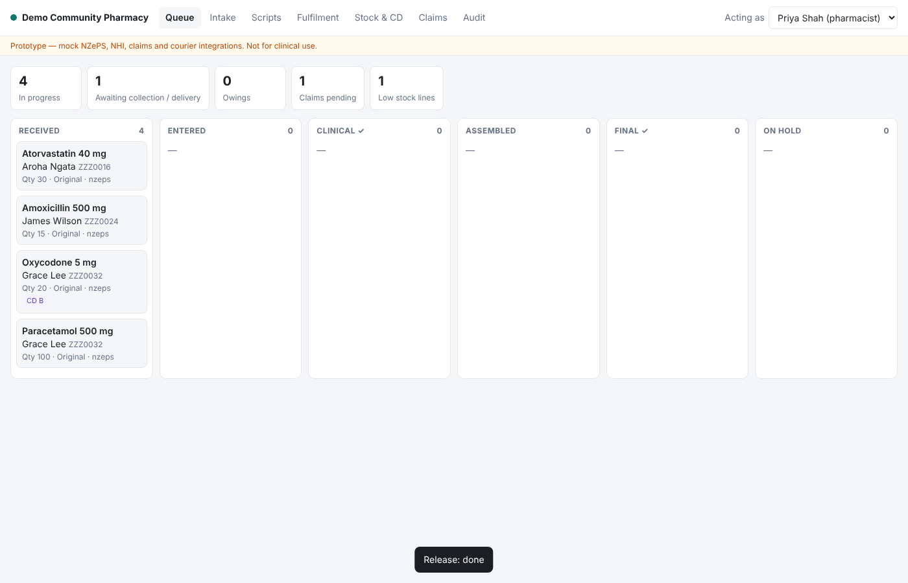

# Dispensing Platform (prototype)

A working prototype of a community-pharmacy dispensing and fulfilment
platform: universal script intake (NZePS e-scripts, paper, signature-exempt,
fax/phone), a role-enforced dispensing workflow, stock and controlled-drug
register, labels, subsidy claims, multi-channel fulfilment (pickup, delivery,
courier, compliance packs) and a tamper-evident audit trail.

> **Not for clinical use.** Every government integration (NZePS, NHI,
> claiming) is a **mock**. This shows the architecture and workflow; it is not
> certified software. See "What's between this and production" below.



## Run it

Requires Node 22.13+. No dependencies to install.

```bash
cd dispensing-platform
npm start            # http://localhost:3000  (data in ./dispensing.db)
npm test             # 22 tests: workflow, roles, repeats, CD register, claims, audit, HTTP
```

Demo flow: **Intake** → click *Use* on a demo e-script → *Fetch script*.
Switch "Acting as" between Lucy (technician) and Priya/Tom (pharmacists) to
move jobs through the queue. James Wilson's amoxicillin script triggers an
allergy warning. Grace Lee's oxycodone is a Class B controlled drug.

## How it works

```
 Script sources (adapters)         Core                                 Outputs (adapters)
 ─────────────────────────         ─────────────────────────────        ──────────────────
 NZePS broker  ──┐                 Canonical prescription               NZePS status update
 Paper / fax   ──┼─▶ normalise ─▶  ▼                                    Claims gateway
 Sig-exempt    ──┘                 Dispense job state machine ──────▶   Courier booking
                                   queued → entered → clinical ✓        Labels
                                   → assembled → final ✓ → released     CD register
                                   → completed (via fulfilment)         Audit log (hash chain)
```

**Universal by design.** The core never talks to a specific system. Each
script source, identity service, payer and courier sits behind a small
adapter interface (`src/adapters/index.js`). Adding a new e-prescription
network, another country's payer or a new delivery partner means writing an
adapter. The dispensing logic doesn't change.

| Area | File | What it enforces |
|---|---|---|
| SCID | `src/domain/scid.js` | 18 chars, check character, I/O read as 1/0 |
| Workflow | `src/domain/workflow.js` | Legal transitions and which roles may perform each |
| Clinical | `src/domain/clinical.js` | Allergy, duplicate therapy, interactions, early repeat; high-severity warnings must be acknowledged with a note |
| Dispensing | `src/services/platform.js` | Separate assembler and final checker (configurable), partial supply and owings, repeat limits, no Class B repeats, stock returned on cancel |
| Controlled drugs | `cd_register` table | Every movement logged with a running balance; proof of collection required |
| Claims | `src/services/platform.js` | One claim per supply, batch submit, CSV export |
| Audit | `src/services/audit.js` | Append-only SHA-256 chain; `/api/audit/verify` detects tampering |
| Broker safety | `transition()` | External calls run after the local commit; failures are logged for retry |

## API (selected)

| Method | Path | Purpose |
|---|---|---|
| POST | `/api/intake/nzeps` `{scid}` | Fetch and queue an e-script |
| POST | `/api/intake/manual` | Queue a paper, fax or phone script (canonical JSON) |
| GET | `/api/queue` | Open jobs with the actions available to the caller |
| POST | `/api/jobs/:id/{enter,clinical-check,assemble,final-check,release,hold,resume,cancel}` | Workflow |
| POST | `/api/items/:id/repeat` | Queue the next repeat |
| POST | `/api/fulfilments/:id/{dispatch,complete,fail,retry}` | Fulfilment |
| POST | `/api/claims/submit` | Submit the pending claims batch |
| GET | `/api/audit/verify` | Verify the audit chain |

The acting user comes from the `X-User-Id` header. This is **prototype only**.

## What's between this and production

Ordered roughly by how much each one blocks you:

1. **Health NZ access and conformance.** The real NZePS spec, a test
   environment, and conformance testing. Confirm the SCID check algorithm (it
   is assumed to be ISO 7064 MOD 37-2 and is isolated in one file).
2. **Claiming integration.** The real Health NZ pharmacy claiming format and
   rules, which come from the community pharmacy services agreement. This is
   the pharmacy's revenue, so it has to be exact.
3. **Medicine data.** Replace the toy formulary with NZULM/NZMT and the
   monthly Pharmac Schedule (subsidies, rules, Special Authority). Replace the
   interaction table with a licensed clinical knowledge base.
4. **Regulatory review.** Label content, record retention, CD register format
   and Class B instalment rules checked by a pharmacist and against the
   Medicines Regulations, Misuse of Drugs Regulations and Pharmacy Council
   standards.
5. **Security.** Real authentication (SSO/MFA), per-user audit identity,
   encryption at rest, NZ data residency, HISO 10029 controls, backups and
   breach procedures. Use Postgres instead of SQLite for multi-user and
   multi-site deployments.
6. **Operations.** Offline mode at the counter, printer and scanner drivers,
   wholesaler ordering, patient notifications (SMS), pharmacy support during
   opening hours.

## Layout

```
src/
  server.js            HTTP API + static UI (no framework)
  db.js                SQLite schema (node:sqlite)
  seed.js              demo staff, formulary, stock
  domain/              pure rules: scid, workflow, clinical, label, errors
  services/            platform (intake, dispensing, fulfilment, claims), audit
  adapters/            mock NZePS, NHI, claims gateway, courier
public/                single-page dispensary UI
test/                  node:test suites
```
