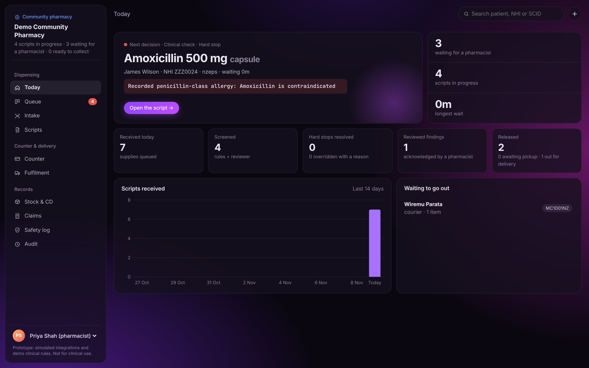
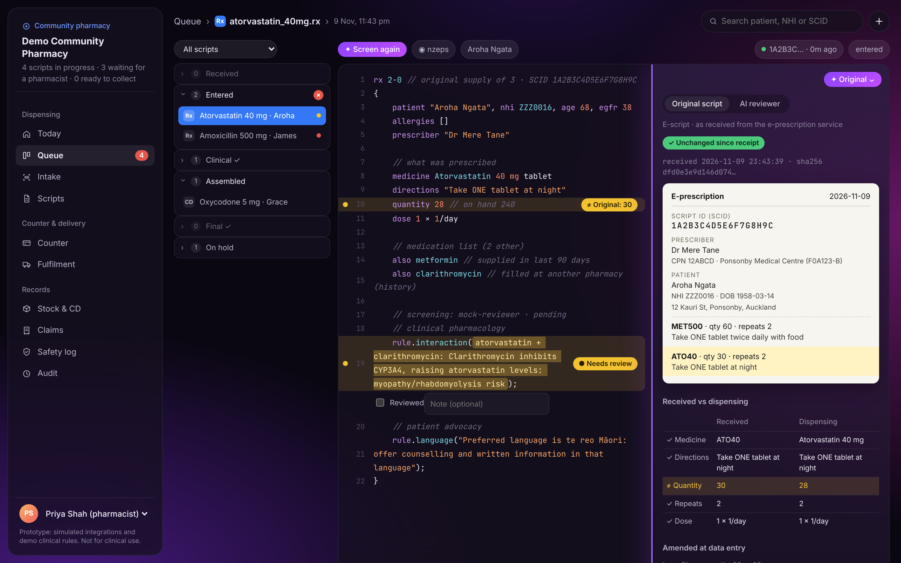

# Dispensing Platform (prototype)

A working prototype of a community-pharmacy dispensing and fulfilment
platform: universal script intake (NZePS e-scripts, paper, signature-exempt,
fax/phone), clinical screening by rules and AI with pharmacist sign-off, a
role-enforced dispensing workflow, stock and controlled-drug register, labels,
subsidy claims, a counter (scripts and over-the-counter products in one
basket), multi-channel fulfilment (pickup, delivery, courier, compliance packs),
reorder drafts, an accounting export and a tamper-evident audit trail.

> **Not for clinical use.** Every government integration (NZePS, NHI,
> claiming) is a **mock**. This shows the architecture and workflow; it is not
> certified software. See "What's between this and production" below.





## Run it

Requires Node 22.13+.

```bash
cd dispensing-platform
npm install          # only needed for the optional Claude reviewer
npm start            # http://localhost:3000  (data in ./dispensing.db)
npm test             # 31 tests
```

**AI reviewer (optional, off by default).** `AI_REVIEWER=claude npm start`
sends a **de-identified** case to Claude for each screening. It sends no name,
NHI, address or date of birth, only an age band. Credentials come from
`ANTHROPIC_API_KEY` or an `ant auth login` profile. Without it, a
deterministic offline reviewer is used.

Demo flow: **Intake** → click *Use* on a demo e-script → *Fetch script*.
Switch "Acting as" between Lucy (technician) and Priya/Tom (pharmacists) to
move jobs through the queue. Opening an entered job runs screening.

- **Aroha Ngata** (metformin + atorvastatin): eGFR 38 triggers a renal dose
  review. Clarithromycin from her medication history interacts with
  atorvastatin (CYP3A4). Metformin has a look-alike/sound-alike pair with
  metronidazole, and she prefers te reo Māori.
- **James Wilson** (amoxicillin): penicillin-class allergy, a **hard stop**.
- **Grace Lee** (oxycodone): Class B controlled drug, so proof of collection
  is required at the counter.

After release, take the pickup code to **Counter**, add over-the-counter
items, and pay.

## How it works

```
 Script sources (adapters)         Core                                 Outputs (adapters)
 ─────────────────────────         ─────────────────────────────        ──────────────────
 NZePS broker  ──┐                 Canonical prescription               NZePS status update
 Paper / fax   ──┼─▶ normalise ─▶  ▼                                    Claims gateway
 Sig-exempt    ──┘                 Dispense job state machine ──────▶   Courier booking
                                   queued → entered → clinical ✓        Labels
                                   → assembled → final ✓ → released     CD register
                                   → completed (via fulfilment)         Audit log (hash chain)
```

**Universal by design.** The core never talks to a specific system. Each
script source, identity service, payer and courier sits behind a small
adapter interface (`src/adapters/index.js`). Adding a new e-prescription
network, another country's payer or a new delivery partner means writing an
adapter. The dispensing logic doesn't change.

| Area | File | What it enforces |
|---|---|---|
| SCID | `src/domain/scid.js` | 18 chars, check character, I/O read as 1/0 |
| Workflow | `src/domain/workflow.js` | Legal transitions and which roles may perform each |
| Clinical | `src/domain/clinical.js` | Allergy, duplicate therapy, interactions, early repeat; high-severity warnings must be acknowledged with a note |
| Dispensing | `src/services/platform.js` | Separate assembler and final checker (configurable), partial supply and owings, repeat limits, no Class B repeats, stock returned on cancel |
| Controlled drugs | `cd_register` table | Every movement logged with a running balance; proof of collection required |
| Claims | `src/services/platform.js` | One claim per supply, batch submit, CSV export |
| Audit | `src/services/audit.js` | Append-only SHA-256 chain; `/api/audit/verify` detects tampering |
| Broker safety | `transition()` | External calls run after the local commit; failures are logged for retry |

## Clinical screening

- **Rules are the safety floor.** Allergy, including drug class (penicillin
  → amoxicillin); dose ceiling from the structured dose; renal avoid/adjust
  from eGFR; duplicated therapy; interactions across the **whole medication
  list** (the dispensing queue, recent supplies, and medicines filled
  elsewhere); early repeats; older adults on CNS depressants; LASA pairs;
  controlled drugs; language needs.
- **Findings are grouped by specialist area:** medication review, clinical
  pharmacology, regulatory, patient advocacy.
- **Every finding carries a reasoning trace:** the inputs used, the rule, and
  its source.
- **The AI only adds recommendations.** It can't raise a hard stop or clear,
  downgrade or remove a rule finding. Rules are re-run at sign-off, so the
  floor reflects the current medication list. If the AI fails, screening
  falls back to rules only.
- **Pharmacist sign-off.** A hard stop needs an override reason plus
  confirmation that the prescriber was contacted. A high finding needs an
  acknowledgement. Every decision goes into the **Safety** log and the audit
  chain.
- **Counselling draft** in the patient's preferred language. Real
  translation needs the AI reviewer enabled.

## The original script: what was received is what is reviewed

- **E-scripts** are stored byte-for-byte as the e-prescription service
  returned them. **Paper, fax and signature-exempt scripts** must have a
  scan or photo (PNG, JPEG or PDF) attached at intake. **Phone orders** are
  marked as verbal.
- Each original is fingerprinted (SHA-256) at receipt, and the fingerprint
  goes into the audit chain. If the stored copy changes, the clinical check
  is blocked.
- The script view's side panel shows the original. For e-scripts it
  compares the received item, field by field, with what is being dispensed
  (medicine, directions, quantity, repeats, dose).
- Data entry may amend directions or quantity, with a reason. Each
  amendment shows as **≠** against the original.
- The pharmacist can't sign off the clinical check without confirming they
  checked against the original. Who confirmed, when, and which fields
  differed are recorded.

## Counter, stock, accounting

- One basket holds released scripts (by **pickup code**) and over-the-counter
  products. Card payment goes through a payments adapter (mock); cash is also
  supported. Payment completes the pickup.
- Refunds need a pharmacist. Over-the-counter items go back into stock.
  Prescription medicines **do not**: returned medicines are destroyed, not
  resold.
- End-of-day totals (prescription vs over-the-counter, refunds, GST, payment
  method). Accounting CSV export in Xero's sales-import column layout, with
  no patient names.
- A stock ledger records every movement. The reorder draft tops each line up
  to its par level or 30-day usage, rounded to whole packs.

## API (selected)

| Method | Path | Purpose |
|---|---|---|
| POST | `/api/intake/nzeps` `{scid}` | Fetch and queue an e-script |
| POST | `/api/intake/manual` | Queue a paper, fax or phone script (canonical JSON) |
| GET | `/api/queue` | Open jobs with the actions available to the caller |
| POST | `/api/jobs/:id/screen` | Run rules + AI screening (pending sign-off) |
| GET | `/api/screening/overrides` | Override and acknowledgement log |
| POST | `/api/counter/sales`, `/api/counter/sales/:id/{lines,pickup,pay,refund}` | Counter |
| GET | `/api/counter/end-of-day`, `/api/accounting.csv`, `/api/stock/reorder` | Reporting |
| POST | `/api/jobs/:id/{enter,clinical-check,assemble,final-check,release,hold,resume,cancel}` | Workflow |
| POST | `/api/items/:id/repeat` | Queue the next repeat |
| POST | `/api/fulfilments/:id/{dispatch,complete,fail,retry}` | Fulfilment |
| POST | `/api/claims/submit` | Submit the pending claims batch |
| GET | `/api/audit/verify` | Verify the audit chain |

The acting user comes from the `X-User-Id` header. This is **prototype only**.

## What's between this and production

Ordered roughly by how much each one blocks you:

1. **Health NZ access and conformance.** The real NZePS spec, a test
   environment, and conformance testing. Confirm the SCID check algorithm (it
   is assumed to be ISO 7064 MOD 37-2 and is isolated in one file).
2. **Claiming integration.** The real Health NZ pharmacy claiming format and
   rules, which come from the community pharmacy services agreement. This is
   the pharmacy's revenue, so it has to be exact.
3. **Clinical content.** Every rule threshold here (dose ceilings, renal
   cut-offs, interactions, LASA pairs) is a demo value. Production needs a
   licensed, maintained knowledge base and pharmacist validation of each
   rule. Evaluate the AI reviewer on real (de-identified) cases before
   trusting it. Check whether it falls under a medical-device regime
   (Medsafe / TGA SaMD), and the privacy implications of sending data
   offshore.
4. **Medicine data.** Replace the toy formulary with NZULM/NZMT and the
   monthly Pharmac Schedule (subsidies, rules, Special Authority). Replace the
   interaction table with a licensed clinical knowledge base.
5. **Regulatory review.** Label content, record retention, CD register format
   and Class B instalment rules checked by a pharmacist and against the
   Medicines Regulations, Misuse of Drugs Regulations and Pharmacy Council
   standards.
6. **Security.** Real authentication (SSO/MFA), per-user audit identity,
   encryption at rest, NZ data residency, HISO 10029 controls, backups and
   breach procedures. Use Postgres instead of SQLite for multi-user and
   multi-site deployments.
7. **Operations.** Offline mode at the counter, printer and scanner drivers,
   wholesaler ordering, patient notifications (SMS), pharmacy support during
   opening hours.

## Layout

```
src/
  server.js            HTTP API + static UI (no framework)
  db.js                SQLite schema (node:sqlite)
  seed.js              demo staff, formulary, stock
  domain/              pure rules: scid, workflow, clinical, label, errors
  services/            platform (intake, screening, dispensing, fulfilment, claims), counter, audit
  adapters/            mock NZePS, NHI, claims, courier, payments; AI reviewer (mock + Claude)
public/                single-page dispensary UI
test/                  node:test suites
```
